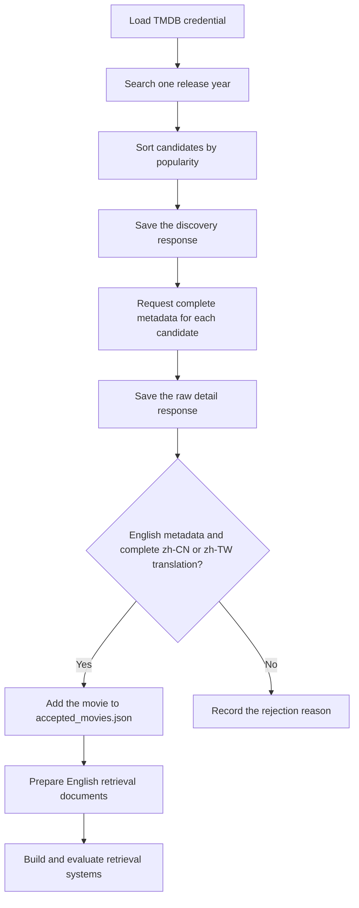

# Multilingual Audiovisual Media Retrieval

This project studies retrieval of movies and television series when the query and document are written in different languages. The initial experiment uses Chinese queries to retrieve English documents. We plan to compare lexical retrieval, translated-query retrieval, and multilingual semantic retrieval.

The current work focuses on building the document collection from The Movie Database (TMDB). The collection script is implemented for movies. TV series will be added through the corresponding TMDB TV endpoints. Animation will be identified using TMDB genre ID `16`; it may be either a movie or a television series.

## Data Selection

TMDB does not provide a discovery filter for translation availability. The script therefore searches for candidate movies, requests the complete metadata for each candidate, and then checks its translations.

Movies are searched one release year at a time. Within each year, results are sorted by popularity because widely viewed titles are more likely to contain complete translations. A movie is included in the bilingual collection when it has:

- a nonempty English title;
- a nonempty English overview; and
- a `zh-CN` or `zh-TW` translation containing both a title and an overview.

The target count refers to movies that pass these conditions, not the number of candidates examined. The script may need to inspect substantially more than 5,000 candidates to collect 5,000 qualifying movies.

## Collection Pipeline



Raw candidate metadata is retained even when a movie does not pass the bilingual filter. This allows the collection process to be audited and resumed without requesting the same details again.

## Setup

Install the Python dependencies:

```powershell
python -m pip install -r requirements.txt
```

Create a `.env` file in the project folder:

```dotenv
TMDB_READ_TOKEN=your_api_read_access_token
```

The `.env` file contains a credential and must not be committed to GitHub.

## Running the Collector

Test the pipeline with 20 qualifying movies from 2025:

```powershell
python collect_tmdb_movies.py --target 20 --start-year 2025 --end-year 2025
```

Collect up to 5,000 qualifying movies across release years:

```powershell
python collect_tmdb_movies.py `
  --target 5000 `
  --start-year 2026 `
  --end-year 1900 `
  --cutoff-date 2026-11-08
```

The collector saves each API response as it is received. If the program is interrupted, running the same command again reuses valid files already stored on disk. Previously accepted IDs are reconstructed from the saved metadata, so increasing the target from 20 to 5,000 does not create duplicate documents.

## Output Structure

```text
project_proposal/
├── .env
├── .gitignore
├── requirements.txt
├── collect_tmdb_movies.py
├── test_tmdb_api.py
└── data/
    ├── raw/                         # Original newest-to-oldest pilot collection
    └── bilingual_movies/
        ├── accepted_movies.json     # IDs and basic information for accepted movies
        ├── collection_summary.json  # Counts, settings, failures, and rejection reasons
        └── raw/
            ├── discover/
            │   └── movie/
            │       ├── year_2026/
            │       └── year_2025/
            └── details/
                └── movie/
                    ├── 123.json
                    └── 456.json
```

`accepted_movies.json` is an index of qualifying records. The complete metadata remains under `raw/details/movie/`. Image paths and video references are stored as metadata, but the associated media files are not downloaded during this stage.

## Planned Extension

The next collection step will add television series using `/discover/tv` and `/tv/{series_id}`. Each normalized record will use a composite identifier such as `movie:129` or `tv:1399` so movie and TV identifiers cannot conflict. Records with genre ID `16` will be marked with `is_animation: true` rather than treated as a separate TMDB media type.
