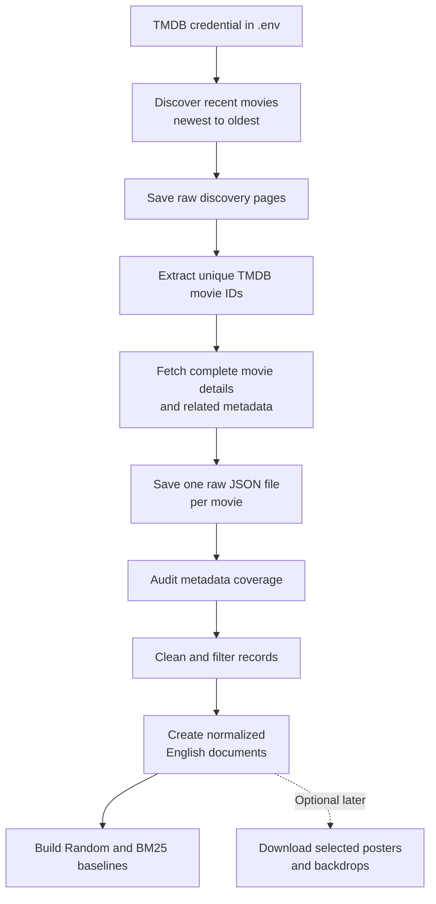

# TMDB Metadata Collection

This folder contains the initial data-collection code for the multilingual and multimodal audiovisual retrieval project. The first collection pass retrieves recent movies from TMDB from newest to oldest and preserves the complete metadata responses. Cleaning and field selection happen afterward, so the original API data remains available if the project needs additional fields later.

The initial target is 4,000-6,000 movie records. TV series, selected known titles, and image downloads can be added after the movie metadata pipeline is working reliably.

## Data Pipeline



**Audit metadata coverage** means checking how complete the raw collection is before filtering it. For example, the audit can report the number and percentage of movies that contain an English overview, release date, genres, credits, translations, poster path, or backdrop path. This stage measures missing data but does not modify the raw JSON files.

## Collect Metadata

Install the required packages:

```powershell
python -m pip install requests python-dotenv
```

Create `.env` in this folder:

```dotenv
TMDB_READ_TOKEN=your_api_read_access_token
```

Test with a small collection:

```powershell
python collect_tmdb_movies.py --target 20
```

Collect 6,000 recent movies:

```powershell
python collect_tmdb_movies.py --target 6000 --cutoff-date 2026-11-07
```

The collector saves every response immediately. If it is interrupted, run the same command again; existing valid JSON files will be reused.

## Folder Structure

```text
project_proposal/
├── .env                         # Local credential; do not commit
├── collect_tmdb_movies.py       # Raw movie metadata collector
├── test_tmdb_api.py             # Authentication test
└── data/
    ├── collection_summary.json
    └── raw/
        ├── discover/
        │   └── movie/
        │       ├── page_0001.json
        │       └── page_0002.json
        └── details/
            └── movie/
                ├── 123.json
                └── 456.json
```

The detail files contain metadata only. Image fields such as `poster_path` and `backdrop_path` are retained, but image files are not downloaded during this stage.

Before publishing the project on GitHub, exclude `.env` from version control. The raw `data/` directory may also be too large for a normal Git repository and should be reviewed before committing.
